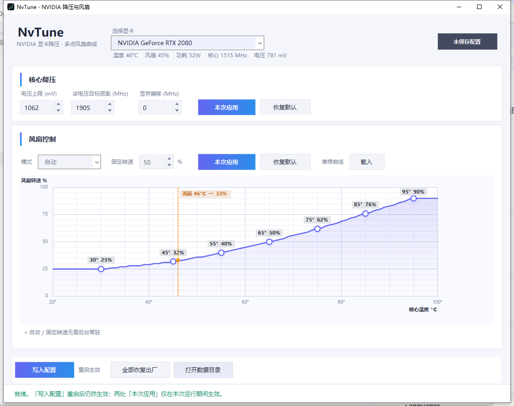

# NvTune

**NVIDIA GPU 降压 & 多点风扇曲线调节 — Windows 图形界面工具**



NvTune 是一个开源的 NVIDIA 显卡调校工具，提供图形化的核心降压（电压上限 + 目标频率）
和多点风扇曲线调节。配置一次，重启后自动生效，无需常驻大体积后台。

## ✨ 功能

- **核心降压** — 设置电压上限与对应核心频率，程序按显卡自身 V/F 曲线自动适配，
  支持 RTX 20 / 30 / 40 / 50 系（GTX 10 系 Pascal 及以上架构均可尝试）。
- **多点风扇曲线** — 温度 20–100 °C、转速 0–100%，最多 12 个控制点，单调三次插值，
  平滑无跳变。双击空白加点、双击圆点删点、拖动调整；单击圆点后可用方向键微调
  （左右 ±1 °C、上下 ±1 %，按住 Shift 步进 5）。
- **风扇模式** — 自动 / 固定转速 / 温度曲线 三种模式一键切换。
- **重启生效** — 「写入配置」后由 Windows 计划任务在每次登录时自动重新应用，
  睡眠唤醒、驱动重置后自动补回。
- **低资源占用** — 固定转速 / 自动模式完全无后台；温度曲线后台每 4 秒读温调节；
  降压看护进程每 20 秒检查一次。
- **多显卡支持** — 自动识别并列出所有 NVIDIA GPU，按显卡身份保存配置，避免写错卡。

## 📦 下载

从 [Releases](../../releases) 下载 `NvTune-win-x64.zip`。解压后运行 `启动器.exe`。

### 系统要求

| 项目 | 要求 |
|------|------|
| 操作系统 | Windows 10 / 11（64 位） |
| 显卡驱动 | 已安装的 NVIDIA 驱动（提供 `nvapi64.dll` 与 `nvml.dll`） |
| .NET | .NET 10 Desktop Runtime (x64) |
| 权限 | 管理员（修改电压与风扇必须提权） |

缺少 .NET 时启动器会弹窗并自动跳转
[dotnet.microsoft.com/zh-cn/download](https://dotnet.microsoft.com/zh-cn/download)。
不需要 SDK、不需要 FanControl 或其它第三方软件。

## 🚀 使用

1. 解压压缩包到任意文件夹，双击 `启动器.exe`。
2. 在顶部选择显卡，设置电压上限 / 目标频率 / 显存偏移。
3. 切换风扇模式：自动、固定转速，或拖动曲线设置温度-转速对应关系。
4. 点 **「写入配置」** —— 保存到 `C:\Program Files\NvTune`，注册开机任务，重启自动生效。
5. 移动或删除解压目录不影响已安装的配置。

### 按钮语义

| 按钮 | 作用 | 重启后 |
|------|------|--------|
| **本次应用**（降压 / 风扇各一个） | 仅本次运行临时生效 | ✕ 恢复已保存配置 |
| **恢复默认** | 临时恢复出厂电压 / 风扇 | ✕ 恢复已保存配置 |
| **写入配置** | 持久保存当前所有设置 | ✓ 自动生效 |
| **全部恢复出厂** | 清除所有配置、停止后台、删除开机任务 | — |

### 后台资源

| 场景 | 后台行为 |
|------|----------|
| 自动 / 固定转速、无降压 | 无后台，完全零占用 |
| 温度曲线 | 每 4 秒读温调节（后台进程） |
| 核心降压 | 每 20 秒检查降压是否仍在（看护进程） |

两者同时开启时共用一个后台进程，内存占用 < 20 MB。

## 🔨 从源码构建

需要 [.NET 10 SDK](https://dotnet.microsoft.com/zh-cn/download)（x64）：

```powershell
git clone https://github.com/Lang-Ke/NvTune.git
cd NvTune
dotnet build src\NvTune.App -c Release
dotnet publish src\NvTune.App -c Release -r win-x64 --self-contained false -o publish
```

启动器单独构建（net48，用于在没有 .NET 10 的机器上检测并引导下载）：

```powershell
dotnet build src\NvTune.Launcher -c Release
```

打包发布目录时，把 `publish` 里的 `NvTuneApp.*` 与 `启动器.exe`、`使用说明.txt`
放在同一层，再压缩即可。

## 📁 项目结构

```
NvTune/
├── src/
│   ├── NvTune.App/        主程序（WinForms, .NET 10）
│   │   ├── MainForm.cs         主界面
│   │   ├── FanCurveEditor.cs   风扇曲线编辑器
│   │   ├── Theme.cs            界面配色
│   │   └── Core/               NVAPI / NVML 交互、持久化、后台进程
│   └── NvTune.Launcher/   启动器（net48，运行时检测 + 下载引导）
└── NvTune.slnx            解决方案
```

## ⚠️ 免责声明

本工具通过 NVAPI 直接写入显卡 V/F 曲线，最坏情况可能导致应用崩溃、驱动重置或系统蓝屏。
程序不会主动提高电压或功耗上限。请自行承担使用风险，作者不对任何硬件或软件损坏负责。

本项目与 NVIDIA Corporation 无关。NVIDIA、GeForce、GTX、RTX 是 NVIDIA Corporation 的商标，
此处仅用于标识兼容的硬件。

## 📄 许可证

[MIT](LICENSE) — 基于 [vuplea/simple-nvidia-undervolt](https://github.com/vuplea/simple-nvidia-undervolt) 派生。
