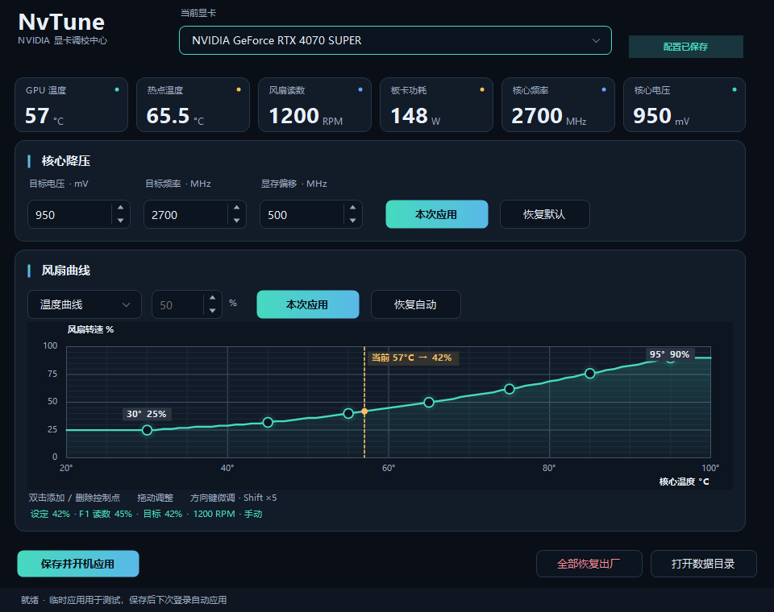

# NvTune

**NVIDIA GPU 降压 & 多点风扇曲线调节 — Windows 图形界面工具**



界面预览使用示例数据。

NvTune 是一个 NVIDIA 显卡调校工具，提供图形化的核心降压（电压上限 + 目标频率）
和多点风扇曲线调节。配置一次，重启后自动生效，无需常驻大体积后台。

## ✨ 功能

- **核心降压** — 设置电压上限与对应核心频率，程序按显卡自身 V/F 曲线自动适配，
  支持 RTX 20 / 30 / 40 / 50 系（GTX 10 系 Pascal 及以上架构均可尝试）。
- **多点风扇曲线** — 温度 20–100 °C、转速 0–100%，最多 12 个控制点，单调三次插值，
  平滑无跳变。双击空白加点、双击圆点删点、拖动调整；单击圆点后可用方向键微调
  （左右 ±1 °C、上下 ±1 %，按住 Shift 步进 5）。
- **风扇模式** — 自动 / 固定转速 / 温度曲线 三种模式一键切换。
- **两个版本** — 安装版保存在 Program Files；便携版的配置和日志保存在 EXE 同目录的 `data` 中。
- **重启生效** — 「保存并开机应用」后由 Windows 计划任务在每次登录时自动重新应用，
  睡眠唤醒、驱动重置后自动补回。
- **低资源占用** — 窗口关闭后，固定转速 / 自动模式且无降压时后台应用一次后退出；温度曲线后台每 4 秒读温调节；
  降压看护进程每 20 秒检查一次。
- **多显卡支持** — 自动识别并列出所有 NVIDIA GPU，按显卡身份保存配置，避免写错卡。
- **热点温度** — GPU 温度右侧单独显示驱动提供的热点读数。不可用时显示“—”和原因，悬停查看详情；恢复后自动刷新。当前仅识别 Pascal、Volta、Turing、Ampere、Ada 的已有热点通道，是否提供读数取决于显卡和驱动，尚未逐型号进行实机验证。Blackwell（RTX 50 系）与未知架构在 NvTune 当前方案中显示“暂不支持”，不会用核心温度或估算值代替；风扇曲线仍按 GPU 温度调节。

## 📦 下载

从 [Releases](../../releases) 按需要选择一个版本，直接双击运行，无需解压。

| 版本 | 下载 | 配置和日志位置 | 登录自动应用 |
|------|------|----------------|--------------|
| 安装版 | [NvTuneApp.exe](https://github.com/Lang-Ke/NvTune/releases/latest/download/NvTuneApp.exe) | `C:\Program Files\NvTune\data` | 运行保存到 Program Files 的程序 |
| 便携版 | [NvTunePortable.exe](https://github.com/Lang-Ke/NvTune/releases/latest/download/NvTunePortable.exe) | EXE 同目录的 `data` | 核验并运行当前便携 EXE |

每个版本都只有一个 EXE。运行时检测由主程序自带的 .NET 启动宿主处理；主程序 DLL、依赖清单和运行时配置都已嵌入 EXE。更新记录和两份文件的 SHA-256 校验值见 GitHub Release。

便携版请放在自己选择的可写文件夹中；安装版点击“保存并开机应用”后会复制到 Program Files。两个版本都会产生配置、日志和运行状态文件。两者共用显卡控制权和一个登录任务，不能同时控制显卡；最后保存的版本负责下次登录自动应用。

### 系统要求

| 项目 | 要求 |
|------|------|
| 操作系统 | Windows 10 / 11（64 位） |
| 显卡驱动 | 已安装的 NVIDIA 驱动（提供 `nvapi64.dll` 与 `nvml.dll`） |
| .NET | .NET 10 Desktop Runtime (x64) |
| 权限 | 管理员（修改电压与风扇必须提权） |

缺少所需运行时时，主程序启动宿主会显示安装提示并提供下载入口。请安装 **.NET 10 Desktop Runtime（x64）**；仅安装基础 .NET Runtime 不足以运行桌面界面。
不需要 SDK、不需要 FanControl 或其它第三方软件。

单文件发布仍依赖本机的 .NET 10 Desktop Runtime（x64）和 NVIDIA 驱动，EXE 不包含这些组件。

## 🚀 使用

1. 下载 `NvTuneApp.exe` 或 `NvTunePortable.exe`，双击运行。便携版请放进准备长期使用的可写文件夹。
2. 在顶部选择显卡，设置目标电压（mV）/ 目标频率 / 显存偏移。
3. 切换风扇模式：自动、固定转速，或拖动曲线设置温度-转速对应关系。
4. 点 **「保存并开机应用」** —— 安装版保存到 `C:\Program Files\NvTune`；便携版保存到 EXE 同目录的 `data`，注册对应版本的登录任务。
5. 便携版搬迁时一起移动 EXE 和 `data`，从新位置运行后再次保存，更新任务路径。安装版保存完成后，移动或删除原下载文件不影响已安装的程序和配置。

安装版更新时，运行新下载的 `NvTuneApp.exe` 并点击“保存并开机应用”，更新 Program Files 中的程序并保留已保存配置。

便携版升级时，先关闭窗口，在程序所在目录的 PowerShell 中运行下面的命令，安全停止后台；若停止失败会提示原因，请处理后重试。

```powershell
Start-Process .\NvTunePortable.exe -ArgumentList '--stop-background' -Wait
```

停止后台会交还自动风扇控制，保留配置和登录任务。随后用新版 EXE 替换原文件，保留旁边的 `data`，运行新版后再次点击“保存并开机应用”。登录任务会核验保存时的 EXE 校验值，替换 EXE 后需重新保存才能继续自动应用。

首次从旧安装版升级时，请先关闭旧版窗口。便携版会兼容已有旧安装的后台接管，并将原 `C:\Program Files\NvTune\data` 的设置导入便携目录；已有便携配置优先。核对参数后点击“保存并开机应用”，将登录任务切换到当前 EXE。旧安装目录中的文件不会自动删除；升级后请使用新版，避免同时启动不支持全局控制锁的旧版本。

两个版本的配置都绑定显卡 UUID。把便携文件夹复制到另一台机器或更换显卡后，请重新核对和保存设置；UUID 不匹配的旧配置不会直接写入新显卡。

### 按钮语义

| 按钮 | 作用 | 重启后 |
|------|------|--------|
| **本次应用**（降压 / 风扇各一个） | 仅本次运行临时生效 | ✕ 恢复已保存配置 |
| **恢复默认** | 临时恢复出厂电压 / 风扇 | ✕ 恢复已保存配置 |
| **保存并开机应用** | 持久保存当前所有设置 | ✓ 自动生效 |
| **全部恢复出厂** | 恢复默认调校与自动风扇、清除保存配置、删除开机任务；成功后关闭窗口，后台自行退出 | 不再应用旧设置 |

### 后台资源

| 场景 | 后台行为 |
|------|----------|
| 自动 / 固定转速、无降压 | 无后台，完全零占用 |
| 温度曲线 | 每 4 秒读温调节（后台进程） |
| 核心降压 | 每 20 秒检查降压是否仍在（看护进程） |

两者同时开启时共用一个后台进程。

窗口打开期间由界面接管风扇控制，并保留一个等待控制权的后台。窗口退出后后台接管；仅自动/固定转速且无降压时，后台完成恢复后退出。失败的风扇操作会继续重试。内存占用及实卡行为需要在目标机器测量。

### 回归检查

Windows + .NET 10 SDK 下运行：

```powershell
dotnet build NvTune.slnx -c Release
dotnet run --project tests/NvTune.Tests -c Release --no-build

# 便携模式也需重新编译后检查
dotnet build NvTune.slnx -c Release -p:Portable=true
dotnet run --project tests/NvTune.Tests -c Release -p:Portable=true --no-build
```

检查使用模拟风扇接口和临时文件，不初始化或写入显卡，不安装程序或注册计划任务。

仅渲染界面与检查高缩放布局（使用示例数据，不初始化显卡）：

```powershell
dotnet run --project tests/NvTune.Tests -c Release -- --render-ui artifacts/ui
```

## 🔨 从源码构建

需要 [.NET 10 SDK](https://dotnet.microsoft.com/zh-cn/download)（x64）：

```powershell
git clone https://github.com/Lang-Ke/NvTune.git
cd NvTune
dotnet build src\NvTune.App -c Release
```

生成与 Release 相同的 Windows x64 单文件主程序：

```powershell
pwsh -File scripts/Publish-Release.ps1 -OutputDirectory artifacts/release
```

脚本分别生成安装版 `NvTuneApp.exe` 和便携版 `NvTunePortable.exe`，打印各自 SHA-256 校验值，并验证单文件部署和软件预览自检。无需构建独立启动器或另外打包 ZIP。便携版使用 `-p:Portable=true` 编译开关；默认构建为安装版，重命名 EXE 不会切换版本。

主程序支持 `--version` 查询版本、`--verify-package` 软件自检，以及 `--stop-background` 在关闭窗口后安全停止后台；自检不初始化显卡、不安装程序、不注册计划任务。

## 📁 项目结构

```
NvTune/
├── src/
│   └── NvTune.App/        主程序（WinForms, .NET 10）
│       ├── MainForm.cs         主界面
│       ├── FanCurveEditor.cs   风扇曲线编辑器
│       ├── Theme.cs            界面配色
│       └── Core/               NVAPI / NVML 交互、持久化、后台进程
├── scripts/Publish-Release.ps1 单文件发布与校验
└── NvTune.slnx            解决方案
```

## ⚠️ 免责声明

本工具通过 NVAPI 直接写入显卡 V/F 曲线，最坏情况可能导致应用崩溃、驱动重置或系统蓝屏。
程序不会主动提高电压或功耗上限。请自行承担使用风险，作者不对任何硬件或软件损坏负责。

本项目与 NVIDIA Corporation 无关。NVIDIA、GeForce、GTX、RTX 是 NVIDIA Corporation 的商标，
此处仅用于标识兼容的硬件。
